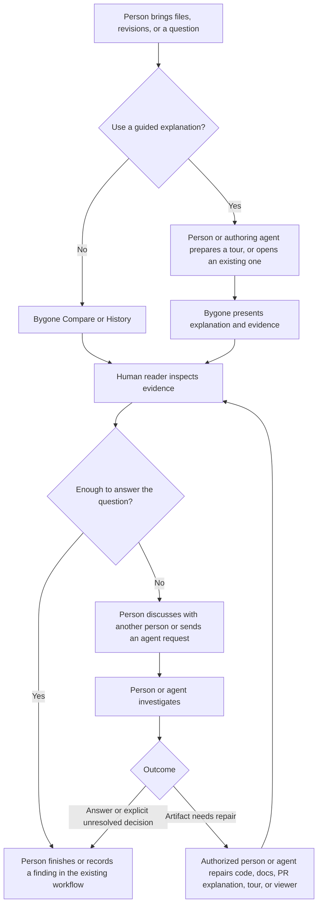

# Bygone: inspect and explain changes within an existing engineering workflow

Product strategy draft. Product priorities are hypotheses, not findings from
representative user research. This map covers the whole product; the recent
strategy work primarily narrows the role of authored tours.

Status checked on 2026-10-12 against `feat/tour-assessment-feedback` at `aceadd4`
and its local, uncommitted skill/prompt changes. Existing comparison and tour
capabilities are distinguished below from branch additions and the external
workflow prototype. This is not a release inventory or verification of current main.

## Product thesis and boundary

**Bygone helps people inspect what changed, how it changed, and the evidence
behind an explanation of that change.**

Direct comparison and history investigation are complete uses of the product.
They need no author, tour, PR, or agent. Optional authored tours select and
sequence evidence when a reader would otherwise have to reconstruct difficult
relationships across files or revisions. A tour should justify its extra
preparation and maintenance cost against the relevant alternative: a good PR
with code links, existing documentation, or direct comparison and history.

Bygone owns inspection and presentation. Existing engineering workflows own
requirements, durable project explanations, discussion, and decisions. For tours,
the opportunity is to keep reasoning connected to inspectable evidence without
creating another system of record.

Confidence: high that this boundary matches the agreed scope and inspected
product surfaces; moderate that authored tours add enough value in the candidate
cases below. Comparative task observations could change the priority or narrow
the audience further.

## Explicit non-goals for Bygone

These are agreed scope boundaries for this strategy, not merely postponed features. Crossing one should require an explicit reconsideration of the product strategy, not an incremental expansion of a tour feature.

1. **Replace README-style or other maintained documentation.** Usage, concepts, architecture, and operational guidance belong in the project's established documentation. A tour may summarize enough to orient a reader and reference those sources; it should not require a parallel version of them.
2. **Become the authority for requirements, design decisions, or change history.** Tickets, agreed requirements, PRs, commits, and existing design records retain their roles. A tour states where an expectation comes from; it does not create authority by restating it.
3. **Replace PR discussion, review approval, or work tracking.** People use their existing venues to discuss tradeoffs and record decisions. Bygone can carry precise evidence into those interactions without owning comments, assignments, approval state, or a competing discussion history.
4. **Become a general agent orchestration, conversation, or memory platform.** Agent requests and review findings remain distinct from the tour document. A useful headless evidence path does not imply that all agent handoffs should use the tour format.
5. **Certify implementation correctness, review completeness, or reader comprehension.** Valid anchors show where evidence exists. Hunk coverage measures code referenced by anchors; deconstructed assignment coverage measures allocation of change units. Neither establishes that behavior is correct, all risks were reviewed, or a reader understands it.
6. **Require a tour for every change or every Bygone session.** Clear implementation, a good PR explanation, or direct Compare/History inspection may complete the job. Skipping a tour is a valid outcome, including for agent-authored changes.
7. **Compensate for avoidably unclear code or missing primary explanations.** Identify the implementation, documentation, or PR rationale as the repair destination. Make repairs within the authorized scope; otherwise expose the gap. A useful tour can still inspect imperfect code without concealing its defects.

These boundaries permit concise contextual explanations, links to existing records, evidence export, and focused integrations that reduce repeated work. They do not forbid persistence or an optional headless workflow. The distinction is whether Bygone helps a reader inspect existing work or starts duplicating ownership of that work.

## Name the actors and artifacts precisely

Actors:

- **Human author:** responsible for proposing and explaining a change; can delegate implementation or explanation work to an agent.
- **Human reader/reviewer:** investigates the change and makes the decisions within their responsibility.
- **Implementation or authoring agent:** inspects or edits implementation and other authorized artifacts. These are task roles, not necessarily different agents.
- **Review agent:** inspects claims and produces findings. Independent investigation must be demonstrated, not assumed from using a separate agent; agreement is not a substitute for evidence.
- **Bygone:** displays evidence, provides navigation and comparison, validates structural grounding, and prepares contextual handoffs. It does not make engineering decisions.

Artifacts:

- **Implementation:** code that produces behavior. Prefer this term to the ambiguous “source.”
- **Tests and check results:** executable expectations and observations from specified runs. A test's existence is different from a passing execution, and neither establishes every behavior.
- **Maintained documentation:** current usage, concepts, architecture, and operational guidance, including README material.
- **Ticket or agreed requirement:** the problem and acceptance criteria. Authority comes from an explicit decision, not merely from being stored in a ticket.
- **PR description and discussion:** the proposal's rationale, review conversation, alternatives, and decisions.
- **Tour document:** a reading path with explanations and code evidence references for a particular purpose and scope. It may be generated or edited by an agent or person.
- **Agent request or reply:** conversation text used for investigation and coordination. A useful reply does not mean any saved artifact changed.

These artifacts can coexist in a repository without becoming interchangeable. A committed tour remains an explanation; a committed claim is not verified merely because it is versioned.

## Where information belongs

| Information or problem | Primary place to address it | Tour's limited role |
| --- | --- | --- |
| Hard-to-read implementation | Improve names, structure, abstractions, or necessary local comments in the implementation. | Explain an irreducible relationship; do not normalize avoidable complexity. |
| How to use or maintain the current system | Maintained documentation and examples. | Point to prerequisites and show the code relevant to this change. |
| Why a change is needed | Ticket, agreed requirement, or PR description. | Briefly orient the reader and identify the source of the expectation. |
| Why this design was chosen | Appropriate design record, PR rationale, or local comment, depending on its useful lifespan. | Connect the rationale to the evidence being inspected. |
| Review objection or design disagreement | Existing PR/ticket discussion or agent conversation, as appropriate. | Supply the passage and code context needed to ask precisely. |
| Check execution and finding | Test/CI output or review record tied to the relevant revision. | Refer to it and accurately describe what it establishes and leaves open. |
| Where to look, in what order, and what relationship to inspect | A reading-order list with code links, or an optional tour when guided navigation adds value. | Keep the explanation and exact evidence together while allowing independent exploration. |

Some repetition is useful for orientation: a one-sentence expectation can make a scene self-contained. Repetition becomes harmful when readers have competing versions of a requirement or rationale, or the author has to maintain the same explanation twice. Do not invent a new authority when sources disagree; expose the disagreement for the responsible person to settle.

Google's guidance already treats a change description as a durable account of what changed and why. Diátaxis already treats explanation as an established documentation need. Bygone should complement that work, not claim those jobs are unserved. Sources: [Google change descriptions](https://google.github.io/eng-practices/review/developer/cl-descriptions.html), [Diátaxis](https://diataxis.fr/).

## The admission question for a tour

**What will this reader struggle to connect, even with clear implementation, relevant documentation, and a good PR description?**

When the medium is open and there is no concrete answer, skip the tour. An explicit
request for a tour selects that medium; honor it with a proportional reading path.
Do not create scenes simply because a branch exists, an agent did the work, or
many files changed.

This is a value comparison, not a prerequisite to perfect every document or
refactor the system. Inspect the available artifacts, identify missing context,
and repair only within authorization. A tour can help expose an unresolved defect.
For historical investigation without a PR, compare against direct History/Compare
and a concise account of the finding.

Candidate cases:

| Case | What remains difficult | What a tour adds | When to skip it |
| --- | --- | --- | --- |
| Behavior crosses several components | Relating input handling, state changes, consumers, and a behavioral check. | A path through the consequential connections at exact code locations. | The relationship is already clear from one small diff and its summary. |
| Intermediate states matter | Understanding compatibility, sequencing, a regression, or why a final diff conceals an important transition. | Selected real revisions in a meaningful order, with relevant comparisons. | The endpoints fully explain the change. |
| Several mechanisms support a claimed guarantee | Evaluating how validation, persistence, and later use interact to enforce a boundary. | Evidence for the relationship plus opportunities to inspect counterexamples. | The guarantee is merely asserted, or relevant evidence is missing. Investigate first. |
| Mechanical edits obscure a small semantic change | Locating the few behavior-changing edits without treating everything else as nonexistent. | Salient entry points with full inventory still available. | A clear PR description and ordinary diff filtering solve it. |
| A particular reader needs help locating a concept in this change | Mapping a known or documented concept onto unfamiliar code. | Brief prerequisite references and contextual navigation. | The real need is a general tutorial or missing maintained documentation. |

These are hypotheses, not categories to implement as new modes. A small change can contain a difficult relationship; a large mechanical change may need no tour.

## Minimum useful tour

Use the smallest reading path that answers the reader's actual question:

1. State the change's consequence and the relevant expectation, drawing from existing agreed material. Identify an inference as an inference.
2. Show the decisive evidence and explain the relationship the reader would otherwise have to reconstruct.
3. State what the evidence established and what remains unresolved.

This is a content discipline within the existing format, not a proposal for new schema fields or fixed scene counts. Clear local code does not need line-by-line narration. Chapters, scenes, and steps earn their place through the reader's task. Numbering helps reference; it does not supply reasoning.

The earlier “change contract” idea should mean a concise restatement of an existing agreed expectation, not a tour-owned specification. If no agreed requirement exists, the authoring agent should expose that uncertainty rather than derive authority from implementation behavior.

Different readers may need different reading paths, prerequisites, or amounts of explanation. They should not receive incompatible versions of the underlying requirement or evidence.

## Personas as situations, not separate products

- **Human reviewer:** “I understand the proposal; help me inspect the relationships that determine whether it works.” Success is a supported finding or decision, including a decision that more evidence is needed.
- **Human author:** “Help the reviewer find and evaluate the consequential parts without making me duplicate my PR description.” Agent assistance can reduce authoring work but must not fabricate intent.
- **Human investigator:** “Help me find the relevant versions and compare them.” History and Compare may complete the job without a tour.
- **Human reader unfamiliar with this area:** “Help me connect the documented concept to this implementation change.” Direct general learning needs to existing docs; do not assume language familiarity from job seniority.
- **Review agent:** “Help me locate the proposed reasoning and evidence efficiently, while leaving me free to investigate beyond it.” Headless value is an experimental use case, not a universal requirement for agent work.

A person can occupy several roles. Codebase, language, and domain familiarity are separate dimensions. Agent authorship is not itself a reason to require a tour.

## Workflow and ownership

This is a proposed journey for a human reader, not a mandatory sequence or an
observed user study. The person can enter through direct inspection or an existing
tour. Agent assistance is optional throughout.

Only the Compare/History and tour-presentation nodes are Bygone product surfaces;
preparation, investigation, and decisions belong to the surrounding workflow.
Readers can move between guided reading and direct inspection. A finding, an
answer with no edits, an explicit unresolved decision, and a repair followed by
verification are all valid outcomes. Finishing a tour does not approve a change.

The branch's **Explain this / Question this change** actions prepare a request
with frozen passage and evidence context. The person manually passes it to an
agent. They do not dispatch work, edit implementation code, post PR comments, or
create a shared feedback inbox. A human-human review can use ordinary discussion
and code links throughout; no agent or Bygone feedback action is required.

### Example: direct inspection, no tour

A **person** compares a working file with a committed revision in **Bygone**,
finds the changed condition, and checks the relevant test. The comparison and
finding answer the question. The person may repair a writable working file or
record the finding in the existing workflow; no tour document or agent is needed.

### Example: cross-file behavior

1. An **agreed requirement**, recorded in a ticket, defines a cancellation expectation. A **human author or implementation agent** changes the implementation, adds a behavioral test, and explains the approach in the **PR description**.
2. The **human author** judges that the relationship between request handling, retry waiting, and cleanup is still hard to inspect. The author or an authorized **authoring agent** prepares a short **tour document** joining those code locations.
3. A **human reviewer** uses **Bygone** to follow the path, then independently inspects a boundary case.
4. The reviewer raises an objection in the **PR discussion**, or manually sends a contextual request to a **review agent**. These are alternative interactions, not one mandatory agent path.
5. The responsible **person or agent** diagnoses the problem and edits the artifact that owns it. A missing README prerequisite belongs in the **README**; a defective cancellation path belongs in the **implementation**; a misleading transition belongs in the **tour**.
6. The **reviewer** checks the relevant evidence and records the decision in the existing workflow. An agent can perform authorized checks, but Bygone does not manufacture approval from completion of the tour.

### Example: historical sequencing

An **investigator** uses **Bygone History/Compare** to discover that a compatibility change only worked because an earlier revision accepted both formats. If another **person** needs to inspect that sequence, the investigator or an **authoring agent** creates a tour of those real revisions. The existing **PR or design record** remains the source of the rollout rationale. If the investigator only needed to diagnose the issue, no tour is necessary.

### Experimental example: an agent handoff without a viewer

An **implementation agent** supplies a diff, existing requirement references, and a concise handoff. A **review agent** may consume a tour document or derived evidence path if it avoids repeated discovery. The review agent still inspects omitted areas and verifies claims against implementation and check results. It returns **review findings** separately; it does not turn the author's narrative into proof by repeating it. An ordinary structured handoff is the baseline to beat.

## Critical capabilities, within this boundary

This inventory combines established product surfaces with the additions on the
inspected branch. It describes capabilities, not release availability. The
external workflow below is a prototype outside the product. Unmarked rows
describe established capabilities; branch additions are labeled.

| Capability and status | Product role | Boundary |
| --- | --- | --- |
| Desktop, VS Code companion, CLI | Enter from the user's current work with the relevant files/revisions. | Entry surfaces, not a new work management system. |
| Two-way and multi-panel diffs, directories, binary/image inspection | Make differences and relationships inspectable. | Preserve the fast comparison workflow; multi-panel diff is not a merge tool. |
| History and scoped search | Locate relevant evidence outside an authored path. | A tour must not constrain the reviewer to favorable evidence. |
| Branch overview, generated presentation, and full file inventory — existing | Establish scope and deterministic reading-order hints without an authored tour. | Generated ranking is not an agent explanation or a correctness judgment; files outside the suggested path remain available. |
| Agent skill, context extraction, tour source, validation and compilation | Produce an optional reading path grounded in code locations. | Validation checks structure and anchor grounding, not behavior or narrative correctness. |
| Opening, chapters/scenes/steps, conclusion | Pace the reasoning needed for this reader and change. | Do not duplicate a README or narrate every changed line. |
| Historical and deconstructed tours | Inspect selected real revision states or a synthetic explanatory sequence. | Label synthetic stages; do not imply they happened as commits. |
| Previous/Next, outline, mode positions, explore/return, narration | Control reading pace and preserve place during investigation. | Readers must be able to leave the tour and examine code independently. |
| Tour details — existing; optional audience — branch addition | Show range, evidence coverage, and available audience assumptions, purpose, scope, or estimated reading time. | Authored expectations are not measured reading level or comprehension; no quality score. Independent modes can describe different audiences. |
| Explain this / Question this change — branch addition | Carry precise passage and code context into an agent request. | Conversation and subsequent edits remain separate; manual handoff today. |
| Writable local panels and editor handoff | Support implementation repair where editing is allowed. | Tour evidence and committed snapshots remain read-only. |
| Local links and portable HTML export | Return to a relevant passage or share a fixed evidence snapshot. | Tour links open the current saved document at its local path. HTML exports freeze included evidence; Minimal/Full have different exploration limits. Neither provides an arbitrary repository environment. |

## What to repair when a reader struggles

Diagnose before increasing the amount of tour prose. An answer may resolve the concern without changing any artifact:

- **Implementation too obscure or defective:** the person or authorized agent improves implementation and checks it.
- **Maintained documentation incomplete:** the person or authorized agent improves that documentation. The tour can reference the result.
- **PR rationale missing or wrong:** the author fixes the PR description through the authorized workflow.
- **Requirement or design disagreement:** responsible people settle it in the existing decision venue; agents expose evidence and alternatives.
- **Tour path or local explanation misleading:** the authoring person or agent edits the tour document.
- **Evidence missing:** a person or agent investigates or runs an appropriate check, or leaves the limit explicit.
- **Bygone loses context or displays the wrong evidence:** fix the viewer/tool defect; do not compensate with more narration.

An agent reply does not update a saved tour, and a code repair does not automatically refresh pinned tour evidence. Recheck affected claims and refresh an ongoing tour for the intended committed range; a preserved historical tour can intentionally keep its original range. Changes to external shared systems still require the appropriate authorization. These are responsibilities, not permission for an agent to post or edit a PR automatically.

## Persistence without a parallel knowledge base

Committing a tour is optional and does not make it the authoritative history of the change. Existing PRs, tickets, commits, design records, and documentation may already preserve what future readers need.

- **One-time reading aid:** keep it with the review workflow or as a disposable artifact when that suffices.
- **Historical walkthrough with reusable navigation value:** persistence can be useful. Pin its scope and evidence; label it as historical. Ensure referenced revisions remain available after history rewriting.
- **Current-system walkthrough:** treat it as maintained documentation with an explicit maintenance cost. Do not adopt this category merely because the format can support it.

A historical tour need not track later implementation evolution, but an incorrect historical explanation still needs correction. A current tour can be stale even when its anchors still resolve. Test whether reuse pays for upkeep before making committed tours routine.

## Product recommendations

1. Make preserving context between explanation and evidence the priority: what claim, which revision, and how to return.
2. Let broader review preparation inspect existing code, docs, and PR/ticket context and choose whether a tour is worthwhile. Keep standalone Bygone authoring focused on the requested tour. Do not infer missing rationale as fact.
3. Prefer the smallest useful path. When the medium is open, help authors finish without a tour when code or a concise PR explanation suffices.
4. Keep one useful reading route readily available, with alternative modes only when they serve the purpose.
5. Preserve direct comparison, history investigation, and normal review outside the tour.
6. Keep question capture precise; test whether better context transfer helps before proposing persistent review state, automatic fixes, embedded chat, or another discussion system.

These priorities guide further work; they are not evidence of user benefit. Local skill/prompt revisions implement the narrower ownership boundary, but the broader product hypotheses remain untested. In particular, this draft does not propose a new schema, documentation importer, ticket synchronization layer, review database, or general agent memory format. Evaluate subsequent proposals against the explicit non-goals above before treating an adjacent capability as part of the roadmap.

## Authoring ownership and external workflow

Keep the viewer, the Bygone authoring skill, and the surrounding review process
distinct. The viewer resolves evidence, presents a reading path, and captures a
reader's concern. It does not need to know which editorial process produced the
tour or own agent orchestration.

The bundled skill is designed to remain sufficient for standalone authoring;
the latest narrowing still needs a real authoring trial. It owns the
current format, revision semantics, evidence anchors, validation, and the minimal
narrative guidance that makes the viewer useful: outcome, scene purpose, causal
reasoning, comparison transitions, and supported conclusions. General editorial
cycles, simulated-reader procedures, and project-history inventories are optional
workflow choices outside that core.

A local, uncommitted prototype now exists at
`~/code/skills-library/skills/prepare-change-for-review/SKILL.md` in the separate
skills-library repository. The agent inspects existing code, docs, requirements,
and PR rationale; repairs the appropriate artifact within authorization; and
chooses whether an evidence tour adds value beyond ordinary code links. A
successful workflow might produce **no tour at all**. An explicit request for a
tour still selects that medium. Optional writing, code-review, or dialogic skills
can be composed when useful, without becoming dependencies of Bygone.

The prototype is not installed by default or bundled into Bygone. After real use,
it may inform an included example; inclusion is not decided. Evaluate the split
by whether the focused authoring skill still produces useful explanations and
whether the external workflow chooses sensible repair destinations and avoids
unnecessary tours. Structural validation alone cannot establish either result.

## What to test next

Use real tasks with a credible baseline: clear implementation, relevant maintained documentation, a good PR description, and existing review tools.

Compare that baseline with (a) a short reading-order list and ordinary code links in the PR and (b) a Bygone tour carrying equivalent explanatory content. This separates the value of writing a better explanation from the value of Bygone's structure and viewer. Include both promising relationship-heavy changes and straightforward changes where no tour should win. Rotate tasks/order and use comparable readers to reduce familiarity effects.

Observe whether human readers correctly explain behavior, predict a consequential boundary case, locate decisive evidence, and retain context during a detour. Count author preparation, reviewer effort, and update/maintenance effort; agent-generated content is not free merely because generation is automatic. Record unsupported confidence and missed defects as well as speed. Do not substitute scene completion, coverage, or satisfaction alone for understanding.

Separately compare an ordinary structured agent handoff with a headless tour-derived path, using equivalent requirements, repository access, tools, and budgets. Measure verified findings, omissions, unsupported claims accepted, and investigation cost. Do not assume a benefit for people implies a benefit for agents, or vice versa.

The near-term decision is whether a bounded class of changes benefits from guided inspection. A small exploratory study can identify failures and promising cases; it cannot establish market demand or statistical certainty. If PR links perform just as well at lower cost, do not force a richer artifact.

## Evidence and limits

Repository grounding (Bygone development checkout): `README.md`, `docs/product-surface.md`, `docs/explore.md`, `docs/present.md`, `docs/sharing-tours.md`, `docs/search.md`, `src/tourDetails.ts`, `src/tourFeedback.ts`, `web/tourDetails.js`, `web/tourFeedback.js`, the bundled authoring skill, and existing tour reasoning plans. Historical proposal documents were not treated as proof of shipped capabilities.

Some repository prose still refers to v4 authoring; the local workspace prompt and bundled skill now request v5. This map uses code for that current behavior rather than treating stale prose as a feature contract. This review checked document/code consistency and the cited framework pages; it did not rerun runtime tests or conduct reader trials. The preceding implementation pass passed the full test suite, targeted lint, and skill validators. Those checks do not establish the strategy's effectiveness.

Framework sources: [Jobs to Be Done](https://www.christenseninstitute.org/theory/jobs-to-be-done/), [journey mapping](https://www.nngroup.com/articles/journey-mapping-101/), [Google review navigation](https://google.github.io/eng-practices/review/reviewer/navigate.html), and the documentation/change-description sources above. These support the distinctions and baseline; they do not validate Bygone's proposed advantage.

Not established: representative demand, frequency of the candidate cases, superiority to a good PR with links, net maintenance savings, agent-review gains, or a need for new integration features. This is a bounded hypothesis to test, not a new implementation mandate.
